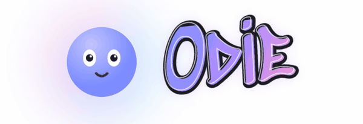
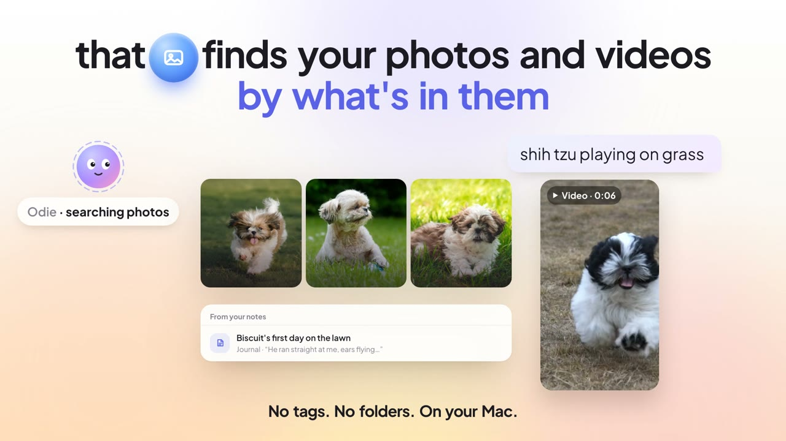
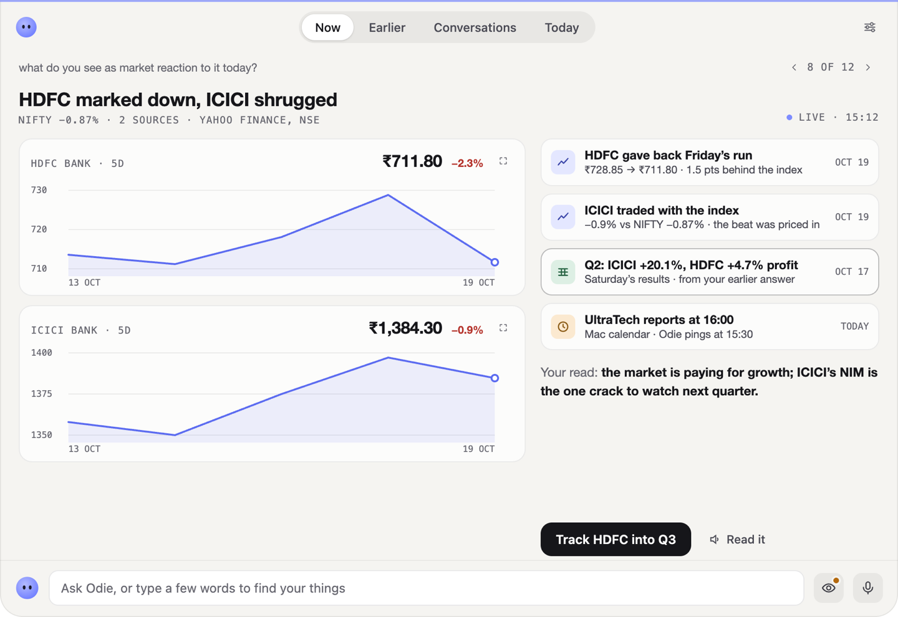

<p align="center">
  <picture>
    <source media="(prefers-color-scheme: dark)" srcset="docs/images/odie-dark.gif">
    
  </picture>
</p>

<p align="center"><b>A personal assistant that lives on your own Mac and talks to you on your phone.</b></p>

<p align="center">
  <a href="docs/media/odie-film.mp4"></a>
  <br><a href="https://youtu.be/LoCgUl9_S2U"><b>▶ Watch the film on YouTube</b></a> · <a href="docs/media/odie-film.mp4">or here</a> (90 seconds, made-up data)
</p>

**Install on a Mac** (macOS 14 or newer, about two minutes; [details](#install)):

```bash
curl -fsSL https://raw.githubusercontent.com/sagarmainkar/odie/main/scripts/get.sh | bash
```

---

Odie reads your notes, your photos, your mail and your calendar, remembers what you tell it, browses the web, runs
commands on your Mac when you tap yes, and answers with pictures as well as words: tables, charts, heat maps, flash
cards, calculators, diagrams, decks and podcasts. The brain is a model you choose, running on your Mac or in the cloud
with your own key. Your data stays in a folder on your Mac. There is no account and no telemetry.

**See it before you set anything up:** once Odie runs, Settings → *See a sample chat* plays a made-up conversation
drawn by the real app, turn by turn. It's the quickest way to see what Odie can show.

## Why Odie, when there's OpenClaw, Hermes and the rest?

Odie is a fun way to live with AI. It's your own app, on your own machine, with your own content, and it can run on
local AI end to end. Three things are worth experiencing:

- **Generative UI.** Answers come back as live tables, charts, calculators, flash cards and diagrams made for that
  question, not as walls of text.
- **Text and image embeddings.** Your notes, photos and videos sit in one index you can search by meaning, on your Mac.
- **No app to install.** Odie is a progressive web app: add it to the Home Screen and it feels native, with push
  notifications on iOS, Android and in the browser.

Odie is inspired by Muse, but it isn't a copy.

## How Odie is different

- **It answers with interfaces, not just text.** The model writes short descriptions of visual blocks and the app
  draws them live: tables, lists, checklists, charts (line, bar, area, stacked, combo, pie, donut), heat maps, KPIs,
  progress, streaks, timelines, flash cards, calculators with sliders, Mermaid diagrams, SVG drawings and animations.
  Every block opens full screen and pinch-zooms. This is generative UI: the layout is made for each answer.
- **It knows your own things, on your Mac.** Point it at an Obsidian vault (or any folder of Markdown notes) and your
  Photos library. One search finds notes, photos and videos together **by meaning**, with a local embedding model
  (EmbeddingGemma 2) on your Mac's GPU: "the trip where we saw snow" finds the note and the pictures.
- **It acts, and asks first.** Sending mail, creating events, running a shell command, installing a skill, typing
  into a signed-in site: each pauses on a card that shows exactly what will happen. Reads never ask.
- **It works while you're away.** Trackers watch a price, an order or a score and tell you when it matters. There's
  a morning brief, reminders spoken in its voice, and a watch over your mail and calendar.
- **It knows itself.** Ask "what can you do?" and Odie reads its live feature list (skills, apps, models, voice,
  trackers, schedules, blocks) instead of guessing.
- **You choose the brain.** LM Studio or Ollama on the Mac, or OpenAI, Claude, Gemini, OpenRouter, Ollama cloud, or
  any OpenAI-style endpoint. One model layer (LiteLLM) speaks to every provider the same way, so switching is a tap.
  A 30-second check tells a model that can do the job from one that can't.

## What it does

### Your notes, photos and videos

- **Notes.** Odie indexes an Obsidian vault (or any Markdown folder) and searches it: always by words, and by meaning
  once you turn on an embedding model. Ask it to save a note and it writes one with a shell command you approve on a
  card. How you organise the vault is up to you. If you have no vault, setup makes one for you
  (`~/Documents/Odie Vault`).
- **Search by meaning.** For the best experience, use EmbeddingGemma 2, Google's local embedding model, which Odie
  runs on the Mac's GPU (Apple Silicon). It gives you search over mixed media (notes, pictures and videos together),
  the results are remarkable, and there's a lot of fun to be had with it. The model is about 1.5 GB, downloaded once
  on first use, and unloads itself after 15 idle minutes. You can also use an embedding model from LM Studio or
  Ollama on this computer, from a server somewhere else on your network (its address and one of its models), or
  OpenAI's: EmbeddingGemma 2 on Ollama (`ollama pull embeddinggemma-2`) reads pictures too, with no model of Odie's
  own to download; the others are text only. Without any, search works by words. EmbeddingGemma 2 is Google's model:
  Odie doesn't include it. It's downloaded from Hugging Face on first use, under its own licence (Apache 2.0).
  Explainer videos are encoded with ffmpeg from the imageio-ffmpeg package, installed with Odie and run as a
  separate program (its bundled ffmpeg is a GPL build); the video kit ships three.js and KaTeX (both MIT).
  Explainer videos can carry pictures (yours or the web's, credited on a closing card), short stock clips and an
  offline map, whose data comes from Natural Earth (public domain; borders as India draws them).
- **Photos and videos.** Odie reads your Photos library (read-only): who is in a picture, where and when, what Photos
  saw in it. Each picture gets one vector from its words and its pixels, so one search covers notes and pictures. A
  video plays in the chat after Odie fetches its original from iCloud.
- **Memory.** What Odie learns about you lives in one Markdown file you can read and edit (`~/.odie/memories.md`).

### Mail, calendar and any other app

Odie connects to apps through **MCP**, the open standard for giving an AI tools. Any MCP server works: add it in
Settings → Connected apps, or in `~/.odie/mcp.json`, running on the Mac or over HTTP. A Gmail or Calendar MCP server
gives Odie your mail and calendar. Zapier and Composio are built-in shortcuts that link many apps at once, but you
don't need them. Tools the server marks read-only run at once; anything that writes asks for a tap.

On a Mac, Odie also reads **Apple Mail, Calendar and Reminders** directly, with no MCP server: allow each
app once in Settings → Mac apps, and macOS asks with its own dialog. Odie reads mail and saves attachments but never
sends from Mail. In chat, adding an event or a reminder asks for a tap; the watch may put a bill's due date on the
calendar by itself. When mail or an event comes through both the Mac and an MCP server, Odie shows it once.

### Working for you in the background

- **Trackers:** "tell me when this drops under ₹20,000", "watch this order", "the score at half time". Checks from
  every 5 minutes to once a week, up to 10 at a time, and a push to your phone when it matters.
- **Morning brief** at 07:30, **reminders** every minute (spoken as a short voice memo), and a **watch** over your mail
  and calendar every 30 minutes for the things you told it to look out for.

### The web and your Mac

- **Browser.** Odie drives the Chrome, Edge, Chromium or Brave already on your Mac, headless, in its own profile, on
  public sites only. Downloads are refused, and it never types into password, card or one-time-code fields.
- **Your Mac.** Shell commands run as you, after you read the exact command on a card. "Allow for 30 min" covers one
  chat, but deleting, sending data out or touching secrets always asks.
- **Making things.** Designed decks (PDF and PowerPoint), Word documents, podcasts with two hosts, narrated
  explainer videos, files. A deck's photos come through Odie's browser, each credited on its slide. The repo ships
  no photos: credited photos belong to their owners, and a deck that uses them is for your own use.

### Voice

Read-aloud and podcasts use Kokoro, a voice that runs on the Mac. OpenAI voices, dictation and live talk are options
with an OpenAI key.

## The ideal setup

| Piece | Best choice | Why |
|---|---|---|
| Computer | One that stays on (see the memory you need below) | Odie runs as a background service and your phone reaches it |
| Brain | Qwen 3.8 27B on your computer; or DeepSeek V4.1 Flash or Claude Sonnet 5.5 in the cloud (see below) | Local keeps everything private; the cloud ones are faster |
| Notes | Your Obsidian vault | Odie finds your own words |
| Search by meaning | On, with EmbeddingGemma 2 (Google's local model) | Notes, photos and videos found by meaning, all on the Mac |
| Photos | Allowed | Pictures and videos join the same search |
| Phone | Tailscale (free), then Odie added to the Home Screen | Odie in your pocket from anywhere, over HTTPS, private to you |
| Mail and calendar | On a Mac, its own Mail and Calendar (Settings → Mac apps); or any Gmail and Calendar MCP server | Odie reads, drafts and watches; sending asks first |
| Web search | A Tavily key (free tier), or Brave or Ollama | Better results than the free fallback |

## How much computer you need

Odie itself needs very little memory or CPU. What needs memory is running the AI models on your own computer.

| Setup | Memory |
|---|---|
| **Everything local:** Qwen 3.8 27B for chat, EmbeddingGemma 2 for search, Kokoro for voice | 24 to 32 GB |
| **Cloud models:** a cloud chat model and OpenAI embeddings | 4 GB is more than enough |

You can mix them, for example a cloud chat model with EmbeddingGemma 2 on your computer.

## Models that suit Odie

Odie needs a model that calls tools reliably, reads what the tools return, and follows the visual-block format.
Settings → Brain → *Check this model* tests exactly that in about 30 seconds.

We've tested Odie on many models. These work best:

| Model | Where | How it does |
|---|---|---|
| **Qwen 3.8 27B** | On the Mac (LM Studio or Ollama) | A good experience, and nothing leaves your Mac. Slower than the cloud models |
| **Gemma 4 26B** | On the Mac (LM Studio or Ollama) | Works, but its visual answers may not be as good |
| **DeepSeek V4.1 Flash** | Ollama cloud (`deepseek-v4.1-flash:cloud`) | Fast, cheap and creative with the visual answers |
| **Claude Sonnet 5.5** | Anthropic key | Fast and creative, reliable with tools |
| **GLM 5.3 Flash** | Ollama cloud (`glm-5.3-flash:cloud`) | Cheap and creative; slower |
| **Claude Opus 5.5** | Anthropic key | The most careful with numbers; costs more |
| **GPT-5.6 Luna and Sol** | OpenAI key | Fast and creative |

Local models depend on how strong a model your Mac can run, so your experience may differ. The trade-off for the speed
you give up is privacy.

Long chats keep every word: past the model's limit (up to 300k tokens), turns older than the last five go to the model
as words only, without their tool traffic and thinking. There's no summary and no restart.

## Install

On a **Mac with macOS 14 or newer**, with [Homebrew](https://brew.sh) (Apple Silicon for everything; an Intel Mac runs
without the local voice and search by meaning, and the installer says so):

```bash
curl -fsSL https://raw.githubusercontent.com/sagarmainkar/odie/main/scripts/get.sh | bash
```

It installs what's missing of `git`, [`uv`](https://docs.astral.sh/uv/) and Node 20+ with Homebrew, puts Odie's own
copy in `~/.odie/app` at the newest release, adds the `odie` command in `~/.local/bin`, starts a background service and
opens setup in the browser. Running it again updates Odie; your data stays. [Read the script](scripts/get.sh) first if
you like.

You'll also want a brain: [LM Studio](https://lmstudio.ai) or [Ollama](https://ollama.com), or a key for a cloud model.
On Linux, see [Mac first, Linux today](#mac-first-linux-today-more-welcome).

Or by hand, with `git`, `uv` and Node 20+ already there:

```bash
git clone https://github.com/sagarmainkar/odie.git && cd odie
scripts/install.sh      # Odie's own copy in ~/.odie/app, the odie command in ~/.local/bin, a background service
odie open               # opens setup in the browser
```

## Setup: Odie sets itself up

Setup is a conversation. First you pick a brain: Odie lists the models it finds on your Mac, or takes a key for a
cloud one, and checks the one you pick. From then on that model walks you through the rest, one step at a time, with
a button for each choice:

1. **Names:** yours, and what to call the assistant.
2. **Notes:** your Obsidian vault, any folder, a new vault, or none.
3. **Search by meaning:** Odie's EmbeddingGemma 2, another embedding model, or words only.
4. **Photos:** allow your Photos library, or skip.
5. **Web search:** a key, or the free fallback.
6. **Voice:** Kokoro on the Mac, or OpenAI's voices.
7. **Apps:** connect mail, calendar and more.
8. **Phone:** Tailscale, then a QR code to pair your phone.

Every step after the names can be skipped and done later in Settings, and *Run setup again* brings back what you
skipped. Keys never pass through the model: you type them into a card that saves them straight to `~/.odie/.env`.

## Your phone: Tailscale and the app

**Tailscale: suggested, not required.** Odie listens only on your Mac itself (`127.0.0.1`), so nothing on the
internet can reach it. To use it on your phone from anywhere, we suggest [Tailscale](https://tailscale.com): it's free
for personal use and puts your Mac and your phone on a private network of your own. Run `tailscale serve --bg 8000`
once on the Mac and Odie gets an HTTPS address that only your devices can open. Without it, Odie works in the Mac's
browser.

**Why there's no app to install.** Odie is a PWA, a web app that installs itself. Open its address on the phone and
choose *Add to Home Screen*: it gets an icon, opens full screen like an app, and receives push notifications (on an
iPhone, push needs that Home Screen install). The same address works on Android and in any desktop browser. There's
no app store and no separate build per platform, and every update reaches every device at once.

**Pairing.** Each new browser pairs once with a one-time code: a QR code on the Mac's screen, or `odie pair` in a
terminal. Unpaired browsers see only the pairing screen.

## Security

We take security seriously, but an agent with shell access is still a risk: a web page, a mail or a document can try
to steer it (prompt injection), and no model is immune. That's why a human stays in the loop. Before Odie runs a
command or acts on your behalf, it shows you exactly what it will do. Read it, and approve only what you'd do
yourself, knowing that you're responsible for it. Never wave a card through, and never trust the agent too much.

- Odie listens on `127.0.0.1` only, and every browser must pair.
- Anything that sends, deletes, buys, books or changes something outside Odie waits for your tap on a card that shows
  the exact command, mail or event. Cards expire after 24 hours. Every tool call goes into an audit log.
- Keys live in `~/.odie/.env`, readable only by you, and are never sent to the phone.
- Skills you install that carry code need your OK before they run.

More in [SECURITY.md](SECURITY.md), including how to report a problem privately.

## Experimental features and known limits

- **Signed-in browsing (experimental, off by default).** Odie can use your accounts on sites through its own browser.
  Logins are kept in the Mac's Keychain and never read by the AI, and typing on a signed-in site asks every time.
- **Headless browsing has limits.** Some sites block or challenge a browser with no window. A captcha or bot check is
  handed to you, and some sites (LinkedIn and X among them) refuse sign-ins from a headless browser.
- **Videos from iCloud** play only after Odie downloads the original, which takes a moment for long ones.

## Privacy

Odie is built to be private, but not limited to it. It can run everything on your Mac: the chat model (LM Studio or
Ollama), search by meaning (EmbeddingGemma 2) and voice (Kokoro, built in). Or you can choose cloud models and cloud
embeddings for any part of it. **Web search is never local**: the search words go to the search provider.

| | Stays on your Mac | Goes out |
|---|---|---|
| Chat model on the Mac (LM Studio, Ollama) | chats, notes, memory, mail it reads | nothing |
| Chat model in the cloud (OpenAI, Claude, Gemini, OpenRouter, Ollama cloud) | your files | each chat turn, with what Odie read for it, to that company |
| Search by meaning with EmbeddingGemma 2 | notes, photos, videos, their vectors | nothing |
| Search by meaning with a cloud embedding model | | the text of your notes, to make their vectors |
| Voices: Kokoro (built in) | speech made here | nothing |
| Voices: OpenAI (optional) | | the text being read, or your voice when dictating |
| Web search (Tavily, Brave, Ollama, or the free fallback) | | the search words |
| Connected apps (MCP) | | whatever that server sends, to wherever it runs |

**Local search, cloud chat.** With EmbeddingGemma 2 on the Mac and a cloud chat model, your photos and videos are
searched on the Mac. The cloud model doesn't see the pictures themselves unless you ask it to look at one: it sees what
the search found (who, where, when, what Photos saw) and the path the app uses to show the picture.

On its own, Odie only checks GitHub for updates (once an hour), reads the public news feeds shown on Today, and
downloads its local models once (from Hugging Face). There is no account and no telemetry.

## Updating

Settings → Odie → *Check now*, then *Update*, or `odie update` in a terminal. Odie moves to the newest release,
builds it, restarts and checks that it's healthy. If anything fails, it goes back to the version you had by itself.
`odie update --rollback` returns to the previous version.

## Mac first, Linux today, more welcome

Odie is Mac first. I built it for my own use and then open-sourced it, so it grew around a Mac. It can work on Linux
today without the Mac-only parts: run it in a terminal with `ODIE_VOICE=off scripts/start.sh` and expect a few
hiccups.

| | macOS 14+ on Apple Silicon | Intel Mac | Linux today |
|---|---|---|---|
| Chat, visual blocks, memory, notes, web, MCP apps, trackers, the phone app | ✓ | ✓ | ✓ in a terminal (`scripts/start.sh`) |
| Search by meaning (EmbeddingGemma 2) | ✓ on the GPU | not Odie's own (PyTorch has no Intel Mac builds); OpenAI or Ollama embeddings with a key | on the CPU only, slower |
| Background service and the `odie` command | ✓ | ✓ | not yet (it uses macOS launchd) |
| Photos and videos | ✓ | by people, place, date and Photos' own words; by meaning only with a cloud embedder | no (it reads Apple Photos) |
| Local voices (Kokoro) | ✓ | no (it runs on Apple's MLX); cloud voices with a key | not yet (it runs on Apple's MLX) |
| Signed-in browsing | ✓ | ✓ | not yet (it keeps logins in the macOS Keychain) |
| Apple Mail, Calendar and Reminders | ✓ | ✓ | no (it uses the Mac apps' own scripting); a Gmail or Calendar MCP server instead |

Contributions are very welcome, for other operating systems and for new features alike: a Linux service, voices and
sign-ins on Linux, a folder of pictures in place of Apple Photos, and anything that makes Odie more fun. See
[CONTRIBUTING.md](CONTRIBUTING.md).

## Odie for Mac is coming. Who wants it?

<p align="center">
  <a href="https://github.com/sagarmainkar/odie/discussions/28"></a>
</p>

The web app is Odie today. A native Mac app is in the works: a small capsule in the menu bar, a pull-down chat,
reminders as banners, a screen snapshot as an attachment, and the same cards, tables and pictures as answers. It will
be a paid client, one-time, about the price of a lunch; the engine in this repo stays free and MIT.

Before I spend more on it, I'd like to know whether anyone besides me wants it: **[say so in the
Discussion](https://github.com/sagarmainkar/odie/discussions/28)** (an upvote is enough; what you'd want from it is
better).

## More

- [Setup guide](docs/setup.md): every setting, connected apps, the `odie` command, where things live.
- [Architecture](docs/architecture.md): how it fits together, on one page.
- [Contributing](CONTRIBUTING.md): the checks, the code style, adding a skill or a block, and how pull requests are
  reviewed.
- [Security](SECURITY.md) · [Changelog](CHANGELOG.md)

## Licence

MIT. See [LICENSE](LICENSE).
