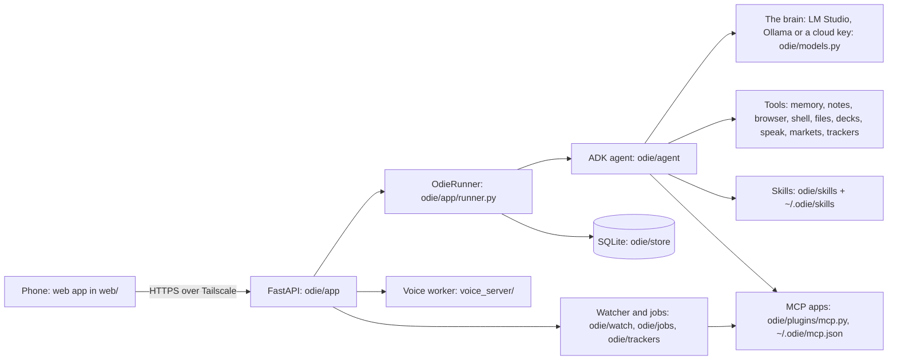

# How Odie fits together

One Python process (FastAPI, uvicorn) serves the web app and runs one agent on Google's ADK. The phone talks to it
over HTTPS on your Tailscale network. Everything it keeps is in `~/.odie`.



## The pieces

| Piece | Where | What it does |
|---|---|---|
| Web app | `web/` (React, TypeScript, Vite, Tailwind) | Chat, Today, Settings, the blocks gallery; a PWA with push. Replies stream over SSE. |
| API | `odie/app/routes.py` | Chat, threads, approvals, pairing, settings, media, voice, setup. |
| Runner | `odie/app/runner.py` | One ADK runner; builds each turn (the user's text, photos, a context note, a nudge to draw), streams events, pauses tools on approval cards, resumes after the tap. |
| Agent and prompt | `odie/agent/` | The system prompt (`prompt.py`): personality, rules, the visual blocks catalogue, the day. Callbacks, the cut that sends a long chat's older turns as words only, tool wrappers. |
| Blocks | `odie/blocks/catalog.json`, `web/src/blocks/` | The visual language: what each block is for, its fields and an example. The model writes a JSON list in an ```` ```odie-blocks ```` fence; the app parses it leniently (drops what doesn't fit, never shows raw JSON) and draws it. |
| Skills | `odie/skills/*/SKILL.md`, `~/.odie/skills/` | Instructions the model loads on demand, with extra tools (`metadata.adk_additional_tools`). Documents, podcast, stocks, trackers, the skill builder. |
| Apps | `odie/plugins/mcp.py` | Each MCP server is a synthetic skill: its tools switch on when loaded. Every tool raises an approval card, unless the user's "Reading doesn't need a tap" switch is on and its name says it reads. |
| Approvals | `odie/store`, `odie/app/routes.py` | Writes pause as a card (the tool, its arguments, what mail it just read); the tap resumes the turn; cards expire after 24 h; everything goes to the audit log. |
| Memory | `odie/memory/` | One Markdown file: topics as `##`, entries as `### Title (date)`. Titles sit in the prompt; matching entries are prefetched per message; a review every few turns saves what's worth keeping. |
| Notes | `odie/vault/` | A folder of Markdown, indexed by keyword and (optionally) by meaning; searched with the notes tools. |
| Watcher | `odie/watch/`, `odie/trackers/` | Finds which app can list mail and events, polls it for trackers ("tell me when she replies") and for what's due. |
| Jobs | `odie/jobs/`, `odie/background.py` | Reminders, the morning brief, news, approval expiry (APScheduler). |
| Browser | `odie/browser/` | The Chrome, Edge, Chromium or Brave on the computer, driven over DevTools in Odie's own profile; public sites; the chat shows live frames. |
| Voice | `odie/voice.py`, `voice_server/` | Read-aloud, podcasts (two hosts), dictation, talk. Kokoro runs locally in the voice worker; OpenAI voices are optional. |
| Store | `odie/store/` | SQLite: settings, memories' index, tasks, approvals, audit, push subscriptions, devices. ADK sessions in their own database. |
| Setup | `odie/setup/` | The first-run conversation: the brain check (`brain_check.py`), names, notes, search, voice, apps, phone. |
| Command | `odie/cli.py` | `odie serve | start | stop | status | pair | logs | update | doctor | uninstall`. |

## A turn, end to end

1. The phone posts a message; the runner adds a short context note (time, what's open) and, when the question
   reads better drawn, a one-line nudge.
2. The agent calls the model with the static prompt (the same bytes every turn, so the provider's cache works),
   the memory index and the thread.
3. Tools run as the model asks: reads at once; a write becomes an approval card and the turn waits.
4. The reply streams to the phone as Markdown; fences the app knows (`odie-blocks`, `odie-images`, `mermaid`,
   code) are drawn as they arrive.
5. Media the tools made (a deck, a podcast, a file) appear under the reply; the thread is saved; a long day is
   summarised into a fresh segment when it nears the context window.
